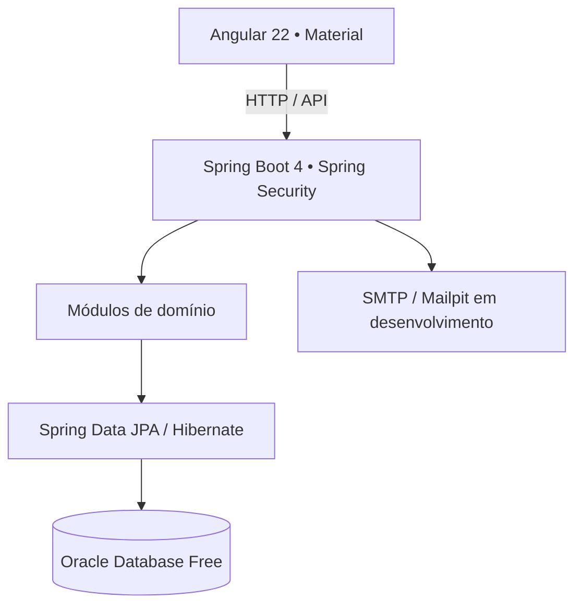

<div align="center">

# NEXUS CRM
### Plataforma Full Stack de Gestão Empresarial

**CRM corporativo multiempresa com Java 21, Spring Boot 4, Angular 22 e Oracle Database.**

Uma aplicação de gestão empresarial com autenticação, controle de acesso, relacionamento com clientes, operações comerciais, atendimento, tarefas, processos e relatórios — desenvolvida com foco em arquitetura modular, segurança e persistência real.

[](https://openjdk.org/)
[](https://spring.io/projects/spring-boot)
[](https://angular.dev/)
[](https://www.oracle.com/database/free/)
[](https://docs.docker.com/compose/)

[**Arquitetura**](docs/arquitetura.md) · [**Documentação da API**](docs/api.md) · [**Como executar**](#-executar-localmente) · [**Validação**](docs/validacao-entrega.md)

</div>

---

## 🎯 Visão geral

O **NEXUS CRM** demonstra o desenvolvimento de uma solução Full Stack orientada a problemas reais de empresas: centralizar clientes, vendas, chamados, tarefas e processos em uma única plataforma.

O projeto adota um **monólito modular** com responsabilidades separadas por domínio, API REST protegida, interface Angular por funcionalidades e banco **Oracle Free** integrado por migrações Flyway. Dados comerciais e indicadores são consultados pela aplicação e pelo banco; não dependem de dados fictícios fixos na interface.

> **Escopo e confiabilidade:** o repositório reúne código, infraestrutura, scripts e documentação. A existência de uma funcionalidade ou script não significa, por si só, homologação de produção. Consulte as [evidências de validação e pendências](docs/validacao-entrega.md).

## ✨ Funcionalidades

| Domínio | Recursos |
|:--|:--|
| 🔐 **Autenticação e acesso** | Configuração inicial, login, recuperação e troca de senha, sessões, perfis e permissões |
| 🏢 **Organizações** | Contexto de empresa e isolamento de dados aplicado no backend |
| 👥 **Clientes** | Pessoas físicas e jurídicas, contatos, validação de CPF/CNPJ, consultas e interações |
| 📈 **Comercial** | Leads, conversão, oportunidades e acompanhamento do funil |
| 🎧 **Atendimento** | Chamados, prioridades, responsáveis, histórico, comentários, prazos e anexos privados |
| ✅ **Tarefas e processos** | Acompanhamento de responsáveis, estados e fluxos de trabalho |
| 📊 **Dashboard e relatórios** | Indicadores alimentados pela API e persistência Oracle; exportação CSV |
| ⚙️ **Administração** | Usuários, perfis, permissões e configurações operacionais |

**Evoluções previstas:** exportação PDF e tema escuro, entre outras melhorias documentadas no [escopo](docs/escopo-e-validacao.md).

## 🧰 Stack tecnológica

| Camada | Tecnologias |
|:--|:--|
| **Backend** | Java 21 · Spring Boot 4.1.1 · Spring MVC · Spring Data JPA / Hibernate · Spring Security · Bean Validation |
| **Frontend** | Angular 22 · TypeScript 6 · Angular Material · SCSS · componentes standalone · formulários reativos |
| **Banco** | Oracle Database Free · JDBC · Flyway · constraints e migrações versionadas |
| **Segurança** | Cookies HttpOnly · SameSite · CSRF · BCrypt · autorização por perfil/permissão |
| **Qualidade** | JUnit · Mockito · Vitest · scripts de verificação e build |
| **Infraestrutura** | Docker · Docker Compose · Nginx · Mailpit (e-mails locais) |
| **Documentação** | OpenAPI / Swagger · documentação de arquitetura · runbooks |

## 🏗️ Arquitetura



**Decisões de engenharia em destaque:**

- **Monólito modular:** separação de responsabilidades sem a complexidade operacional inicial de microsserviços.
- **API e persistência reais:** DTOs, validações, regras de negócio, JPA e migrações de banco.
- **Autorização no servidor:** menus e filtros da interface não substituem verificações de acesso no backend.
- **Segurança de sessão:** cookie HttpOnly, token CSRF para operações mutáveis e recuperação de senha com tokens temporários.
- **Infraestrutura reproduzível:** scripts para inicialização, diagnóstico, testes, build e execução em containers.
- **Cuidados operacionais:** volume Oracle persistente, arquivos de configuração privados e procedimentos documentados de backup/restauração.

Leia os detalhes em [Arquitetura e isolamento entre empresas](docs/arquitetura.md) e [API e segurança HTTP](docs/api.md).

## 📁 Estrutura do repositório

```text
NEXUS/
├── backend/           # API Java, módulos, segurança e migrações Flyway
├── frontend/          # Aplicação Angular, core, shared e funcionalidades
├── infra/             # Oracle, Nginx, containers e arquivos Compose
├── scripts/           # Inicialização, ambiente, testes, build e operações
├── docs/              # Arquitetura, API, validação e runbooks
├── e2e/               # Artefatos de teste ponta a ponta
├── .vscode/           # Configurações e tarefas de desenvolvimento
├── .env.example       # Modelo de configuração, sem credenciais reais
└── .nvmrc             # Versão Node utilizada no projeto
```

## 🚀 Executar localmente

### Pré-requisitos

- Linux com **JDK 21**, Git, Bash, Python 3 e curl.
- **Docker Engine** e **Docker Compose plugin**.
- **NVM** para utilizar a versão Node especificada em `.nvmrc`.
- VS Code é opcional, mas recomendado.

> Ambiente original: Linux Mint 21.1. Para outras distribuições, ajuste a instalação das ferramentas conforme a documentação oficial. Não reutilize credenciais nem volumes de outra instalação.

### 1. Clone o projeto

```bash
git clone https://github.com/WalterMatheusgg/NEXUS.git
cd NEXUS
```

### 2. Prepare Node e segredos locais

```bash
. "$HOME/.nvm/nvm.sh"
nvm install
nvm use

./scripts/init-env.sh
chmod 600 .env
./scripts/doctor.sh
```

`init-env.sh` cria a configuração local **somente se `.env` ainda não existir**, com segredos gerados e sem exibi-los. **Não versione `.env` ou senhas reais.** Se você já utiliza uma instância, preserve seu `.env` e seu volume Oracle existentes.

### 3. Suba os serviços de desenvolvimento

```bash
./scripts/up.sh db
./scripts/up.sh mail
```

Espere o Oracle ficar saudável. Em dois terminais separados:

```bash
./scripts/dev.sh backend
```

```bash
./scripts/dev.sh frontend
```

| Serviço | Endereço local |
|:--|:--|
| **Frontend Angular** | http://127.0.0.1:4200 |
| **API Spring Boot** | http://127.0.0.1:18080 |
| **Mailpit (SMTP local)** | http://127.0.0.1:8025 |

O Angular encaminha `/api/*` para a API em desenvolvimento. O Mailpit captura mensagens **apenas localmente**.

### 4. Verifique a integração

```bash
./scripts/health.sh
./scripts/health.sh http://127.0.0.1:4200/api
```

O status `UP` confirma a probe de saúde, **não** substitui testes funcionais, de autorização ou de isolamento entre organizações.

### 5. Primeiro acesso

Quando a instalação ainda não foi provisionada, abra o frontend e utilize o fluxo de **configuração inicial** para criar a organização e seu administrador.

O token necessário está em `NEXUS_SETUP_TOKEN`, dentro do `.env` local. **Não compartilhe esse token nem coloque credenciais em commits, screenshots ou logs.** Não existe conta de demonstração com senha fixa.

Mais informações: [API e segurança](docs/api.md).

## 🧪 Testes e build

Com o Oracle e a configuração local disponíveis:

```bash
./scripts/test.sh
./scripts/build.sh
```

O backend utiliza testes contra **Oracle real**, sem H2; o frontend utiliza Vitest. Os scripts também aceitam seleção por componente, descrita no runbook.

> Execute testes com dados de desenvolvimento/teste: a suíte pode gravar registros. Para resultados efetivamente observados, limitações e pendências, consulte [Validação da entrega](docs/validacao-entrega.md).

## 🐳 Execução em containers

Para subir a pilha local usando a infraestrutura Compose:

```bash
./scripts/up.sh all
./scripts/health.sh http://127.0.0.1:8081/api
```

**Aplicação em containers:** http://127.0.0.1:8081

A interface é servida pelo Nginx, que também encaminha chamadas à API. Segredos não devem ser incorporados às imagens.

**Atenção:** não execute `docker compose down -v` se precisar preservar dados; o parâmetro `-v` remove volumes. Consulte o [runbook](docs/runbook.md) antes de alterar a infraestrutura existente.

## 🔒 Segurança e privacidade

A aplicação inclui mecanismos de autenticação e autorização por sessão e organização. Uploads ficam fora do frontend público e downloads exigem autenticação e vínculo adequado. Recursos de segurança no código não eliminam a necessidade de revisão, testes de invasão, TLS, política de retenção, backups ensaiados e configuração segura para uso externo.

**Não há declaração de certificação bancária, de homologação de produção ou de conformidade legal automática.** Veja [privacidade e retenção](docs/privacidade.md) e [preparação de produção](docs/producao.md).

## 📚 Documentação técnica

| Documento | Conteúdo |
|:--|:--|
| [Arquitetura](docs/arquitetura.md) | Estrutura modular e isolamento por organização |
| [API](docs/api.md) | Contratos HTTP, autenticação e recursos |
| [Escopo e validação](docs/escopo-e-validacao.md) | Critérios de aceite e evolução funcional |
| [Validação da entrega](docs/validacao-entrega.md) | Evidências, testes executados e pendências |
| [Runbook](docs/runbook.md) | Operação local e solução de problemas |
| [Produção](docs/producao.md) | Infraestrutura, segurança e publicação |
| [Backup e restauração](docs/backup-restauracao.md) | Procedimentos de proteção de dados |
| [Privacidade](docs/privacidade.md) | Proteção de dados e retenção |

## 👨‍💻 Autor

**Walter Matheus Soares da Silva**  
Desenvolvedor Full Stack | Java · Spring Boot · Angular

[](https://github.com/WalterMatheusgg)

---

<div align="center">

**NEXUS CRM** · Engenharia Full Stack com foco em arquitetura, segurança e software empresarial.

</div>
