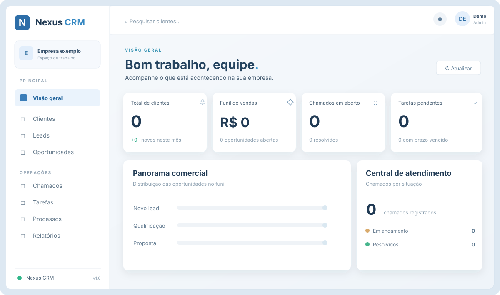
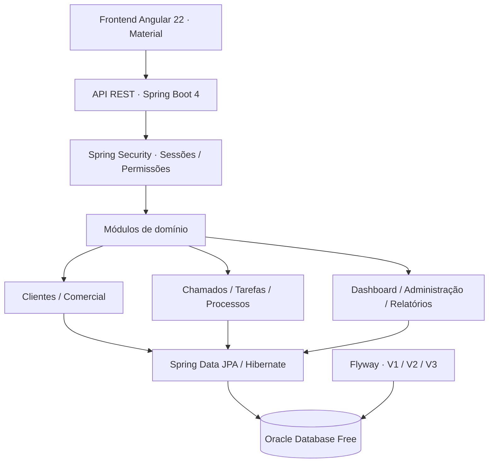

<div align="center">

# NEXUS CRM
### Plataforma Full Stack de Gestão Empresarial

**Gestão de clientes, vendas e operações em um único sistema, com Java 21, Spring Boot 4, Angular 22 e Oracle Database.**


[**Dashboard**](#-painel-do-nexus) · [**Funcionalidades**](#-funcionalidades) · [**Arquitetura**](#-arquitetura) · [**Executar**](#-execução-local) · [**Documentação**](#-documentação)

</div>

---

## 🖥️ Painel do NEXUS

<div align="center">



</div>

A experiência do NEXUS foi organizada para conectar **gestão comercial e operação**: menu lateral por módulos, pesquisa de clientes, notificações, indicadores de negócio e ferramentas para o trabalho diário. O dashboard consulta informações da API Java e da base Oracle.

## 🎯 Sobre o projeto

O **NEXUS CRM** é uma plataforma Full Stack voltada à gestão empresarial de pequenas e médias organizações. O projeto foi estruturado como um **monólito modular**, com domínios bem definidos, regras de negócio centralizadas no backend, frontend Angular por funcionalidades e persistência em banco de dados real.

O sistema reúne autenticação, cadastro de clientes, relacionamento comercial, chamados, tarefas, processos, relatórios e administração. A separação de dados por organização é aplicada no servidor.

## ✨ Funcionalidades

| Módulo | Recursos |
|:--|:--|
| 🔐 **Autenticação** | Configuração inicial, login, sessão, recuperação de senha, perfis e permissões |
| 🏢 **Organizações** | Contexto empresarial e isolamento de dados entre organizações |
| 👥 **Clientes** | PF e PJ, documentos, contatos, pesquisa, histórico e validação |
| 📈 **CRM comercial** | Leads, oportunidades, conversão e acompanhamento do funil |
| 🎧 **Chamados** | Atendimento, responsáveis, prioridades, histórico, prazos e anexos |
| ✅ **Tarefas e processos** | Planejamento de atividades, fluxos e acompanhamento de responsáveis |
| 📊 **Dashboard e relatórios** | Indicadores e relatórios com dados consultados na API/Oracle, exportação CSV |
| ⚙️ **Administração** | Usuários, equipes, funções, permissões, configurações e auditoria |

## 🧰 Tecnologias

| Camada | Ferramentas |
|:--|:--|
| **Backend** | Java 21 · Spring Boot 4.1.1 · Spring MVC · Spring Data JPA/Hibernate · Spring Security |
| **Frontend** | Angular 22 · TypeScript · Angular Material · SCSS · Formulários reativos |
| **Banco** | Oracle Database Free · Flyway · SQL · Migrações versionadas |
| **Segurança** | Cookies HttpOnly · CSRF · BCrypt · Perfis e permissões no backend |
| **Qualidade** | JUnit · Mockito · Vitest · Scripts de testes e build |
| **Infraestrutura** | Docker · Docker Compose · Nginx · Mailpit para e-mails locais |
| **Documentação** | OpenAPI / Swagger · Runbooks · Arquitetura |

## 🏗️ Arquitetura



**Organização do código:**

```text
NEXUS/
├── backend/       # API, regras de negócio, segurança e persistência
├── frontend/      # Aplicação Angular e módulos de interface
├── infra/         # Docker, Oracle, Nginx e Compose
├── scripts/       # Ambiente, diagnóstico, testes e build
├── docs/          # API, arquitetura, validação e operação
├── e2e/           # Testes de integração da aplicação
├── .env.example   # Modelo de configuração
└── .nvmrc         # Versão Node do projeto
```

A implementação segue separação entre controllers, serviços, repositórios, DTOs e validações, com autenticação e autorização no backend. Consulte a [arquitetura detalhada](docs/arquitetura.md) e a [documentação da API](docs/api.md).

## 🚀 Execução local

**Pré-requisitos:** JDK 21, Docker Engine, Docker Compose, Git, Bash e NVM. O ambiente original utiliza Linux Mint; veja o [runbook](docs/runbook.md) para configurações adicionais.

### 1. Clonar o repositório

```bash
git clone https://github.com/WalterMatheusgg/NEXUS.git
cd NEXUS
```

### 2. Configurar o ambiente

```bash
. "$HOME/.nvm/nvm.sh"
nvm install
nvm use

./scripts/init-env.sh
chmod 600 .env
./scripts/doctor.sh
```

O `init-env.sh` prepara a configuração local quando `.env` ainda não existe. Preserve os segredos e volumes de instalações existentes.

### 3. Iniciar Oracle e e-mails locais

```bash
./scripts/up.sh db
./scripts/up.sh mail
```

Em terminais diferentes:

```bash
./scripts/dev.sh backend
```

```bash
./scripts/dev.sh frontend
```

| Serviço | Endereço |
|:--|:--|
| **Angular** | http://127.0.0.1:4200 |
| **API REST** | http://127.0.0.1:18080 |
| **Mailpit** | http://127.0.0.1:8025 |

### 4. Primeiro acesso e saúde da API

Acesse o Angular e siga o fluxo de configuração da primeira organização e seu administrador. O token de configuração é armazenado localmente em `NEXUS_SETUP_TOKEN`; não compartilhe credenciais ou tokens.

```bash
./scripts/health.sh
./scripts/health.sh http://127.0.0.1:4200/api
```

### Containers completos

```bash
./scripts/up.sh all
./scripts/health.sh http://127.0.0.1:8081/api
```

O frontend pode ser servido pelo Nginx em **http://127.0.0.1:8081**. Não utilize `docker compose down -v` se precisar preservar o volume do Oracle.

## 🧪 Testes e qualidade

```bash
./scripts/test.sh
./scripts/build.sh
```

O projeto utiliza testes Java/JUnit com Oracle, testes Angular/Vitest e verificações de infraestrutura.

**Registro de validação de 17/10/2026:** 44 testes de backend, 12 de frontend e 7 de infraestrutura aprovados; build Angular e smoke test de login, dashboard, clientes e chamados concluídos localmente. Os resultados são históricos e estão documentados em [Validação da entrega](docs/validacao-entrega.md).

## 🔒 Segurança

A aplicação inclui controle de sessão, permissões, separação por organização e tratamento de erros. Os mecanismos devem ser complementados por testes de segurança, configuração TLS, auditoria operacional, backups ensaiados e gestão adequada de segredos antes de uma implantação externa.

O repositório **não representa uma versão homologada para produção**. O planejamento técnico está detalhado em [Preparação de produção](docs/producao.md).

## 📚 Documentação

| Recurso | Descrição |
|:--|:--|
| [Arquitetura](docs/arquitetura.md) | Componentes, decisões e isolamento por organização |
| [API](docs/api.md) | Endpoints e autenticação |
| [Escopo](docs/escopo-e-validacao.md) | Funcionalidades e próximos passos |
| [Validação](docs/validacao-entrega.md) | Evidências de testes e pendências |
| [Runbook](docs/runbook.md) | Execução e diagnóstico |
| [Produção](docs/producao.md) | Infraestrutura e implantação |
| [Backup e restauração](docs/backup-restauracao.md) | Proteção do Oracle |
| [Privacidade](docs/privacidade.md) | Proteção e retenção de dados |

---

<div align="center">

**NEXUS CRM** · Engenharia Full Stack · Java + Spring Boot + Angular + Oracle

Desenvolvido por [**Walter Matheus**](https://github.com/WalterMatheusgg)

</div>
