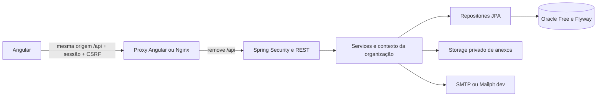

# Arquitetura do Nexus CRM

## Monólito modular

O backend é um único aplicativo Spring Boot, com módulos em `com.nexuscrm`: `auth`, `administracao`, `clientes`, `comercial`, `chamados`, `tarefas`, `processos`, `relatorios` e `dashboard`. `security` centraliza filtros HTTP; `shared` contém contexto autenticado, paginação, entidades base e erros. Controllers recebem DTOs validados; services controlam regras/transações; repositories JPA/Hibernate persistem no Oracle.

O frontend Angular usa componentes standalone, rotas por funcionalidade, formulários reativos, Material e SCSS. `core` concentra sessão, API, interceptor, guard e shell; `shared` oferece formulários/listagens reutilizáveis. Configurações por funcionalidade definem campos e ações. Essa reutilização deve evoluir quando regras específicas exigirem telas próprias; não deve deslocar autorização ou integridade para o navegador.

Os contratos HTTP não expõem entidades Java. Instantes usam ISO 8601; valores financeiros persistem com precisão decimal. Listagens paginam no servidor, limitam `size` a 100 e validam ordenação. Relatórios têm limite de 10 mil linhas e CSV como primeira exportação.

## Organizações e autorização

O contexto autenticado fornece organização e usuário. Endpoints não aceitam `organizationId` do navegador para escolher a empresa. Consultas aplicam esse contexto tanto em leitura quanto em alteração. IDs inacessíveis de outra empresa devem responder como recurso inexistente, sem revelar sua existência.

Entidades de negócio têm `ORGANIZATION_ID` obrigatório, datas e versão de concorrência. Referências compostas `(ORGANIZATION_ID, ID)` impedem relações entre empresas no Oracle, além das verificações nos services. Integridade referencial e filtragem/autorização são ambas necessárias.

Permissões pertencem a um catálogo no backend. Usuários e perfis pertencem à organização; administradores gerenciam os perfis da empresa autenticada. Menus e guards melhoram a experiência; os endpoints impõem as permissões mesmo em chamadas diretas.

Setup provisiona a primeira organização, cinco perfis e um administrador com dados fornecidos pelo operador. Não há conta/senha fixa nem dados comerciais seed. O modelo suporta mais de uma empresa, mas não há cadastro público de organizações nem console de operador SaaS nesta versão.

## Autenticação e sessão

Login recebe código da empresa, e-mail e senha, verifica hash BCrypt e estabelece sessão. `NEXUSSESSION` é HttpOnly/SameSite=Lax. `XSRF-TOKEN` é legível pelo Angular e enviado em `X-XSRF-TOKEN` nas mutações, inclusive login, setup e redefinição. Logout encerra sessão e cookies.

Inatividade expira em 30 minutos por padrão, com até cinco sessões por usuário na instância. Sessões e limitador são locais; múltiplas réplicas exigem estratégia compartilhada e testes. Cookies Secure dependem de `NEXUS_COOKIE_SECURE=true` em HTTPS. Senhas e sessão não são armazenadas em localStorage.

Redefinição usa token temporário de uso único, com hash na tabela de reset e fila SMTP no Oracle. A fila precisa guardar o link até enviá-lo; seu corpo é limpo depois do envio e os registros são removidos pela retenção. Isso exige restringir acesso também à fila, não somente à tabela de hashes. A resposta é genérica para não revelar contas. Alterações de permissões/estado precisam valer nas chamadas seguintes.

## Oracle e migrações

Oracle Free roda em Docker com volume persistente e porta loopback. A aplicação usa conta da PDB, sem SYS/SYSTEM. Flyway controla SQL versionado; Hibernate valida com `ddl-auto=validate`. `V1` existente foi preservada; `V2` adiciona identidade/administração e `V3` os negócios. Migrações aplicadas não devem ser editadas.

Auditoria/históricos não devem copiar senhas/tokens. Clientes são inativados preservando vínculos. Retenção de auditoria/notificações é configurável; dados comerciais, anexos e atendimento a titulares exigem política por empresa e procedimentos documentados.

## Operação e evolução

Desenvolvimento executa Java e Angular no host com Oracle/Mailpit em Compose. O empacotamento opcional usa containers, Nginx como entrada, anexos em volume próprio e logs rotacionados. Probes não comprovam um fluxo funcional completo.

Para implantação maior, revise sessões e limitador distribuídos, observabilidade externa, análise de malware, storage de objetos, segredos, capacidade Oracle, restauração, acessibilidade e desempenho. PDF e tema escuro são posteriores conforme o escopo original. Não há garantia de disponibilidade empresarial sem homologação e operação.
